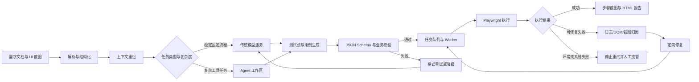
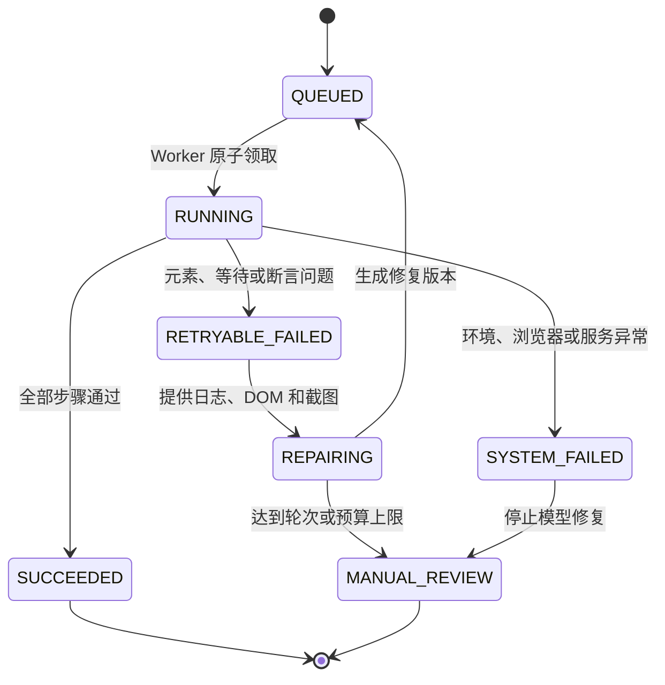

# 从需求文档到自动执行：企业级测试智能体工程复盘

> 一份面向求职展示的脱敏技术案例，重点说明如何把不稳定的大模型能力封装为可校验、可执行、可追踪、可恢复的测试工作流。

## 公开说明

本仓库是本人基于实际项目经历撰写的脱敏工程复盘，仅用于展示通用的 Agent 架构设计、Skill 设计方法、结构化协议、自动执行、失败修复与评测思路。

仓库不包含原单位源代码、内部 Prompt、真实 Skill 文件、客户数据、数据库结构、账号、接口地址、内部截图或其他非公开资料。示例数据、字段、流程图和协议均为重新编写的通用示例，不代表原系统的完整实现。

## 1. 项目概览

真实的软件需求文档通常同时包含正文、流程图、UI 截图和数据表。人工将这些内容整理为测试点和测试用例，需要持续核对业务规则、边界条件与异常分支；如果直接让大模型一次性生成最终结果，又容易出现上下文遗漏、结构不稳定、步骤无法执行和失败后难以定位等问题。

本项目探索了一条从需求理解到测试交付的完整链路：

```text
需求文档与 UI 截图
    -> 文档解析与上下文重组
    -> 测试点生成
    -> 结构化测试用例生成
    -> 协议校验
    -> Playwright 自动执行
    -> 日志、DOM 与截图采集
    -> 失败归因与定向修复
    -> 仅重跑失败项
    -> HTML 测试报告
```

系统同时保留传统模型服务和 Agent 两条路线：稳定、格式固定的任务优先走传统链路；需要读取工作区、调用工具并根据反馈迭代的复杂任务进入 Agent 链路。两条路线共享结构化用例协议，并设置超时、校验、重试与降级边界。

## 2. 我的工作

项目由团队协作完成。我的工作重点随项目阶段发生变化：

- 一期建设：负责 Web 前端架构与核心数据交互，完成测试点解析、脑图展示和生成结果的查看与修改流程。
- 升级建设：工作重点转向 Java 业务服务与 Python 模型服务，参与贯通需求解析、测试点生成、结构化用例、自动执行、失败修复和报告输出。
- 协议与执行：参与设计兼顾人工阅读与机器执行的用例 JSON 协议，以白名单动作描述点击、输入、等待和断言。
- 任务与稳定性：在 Java 侧处理任务状态、Worker 并发、独立工作区、进度心跳、日志持久化，以及模型异常、进程超时和输出解析失败等场景。
- 浏览器自动化：基于 Playwright 完成 DOM 探测、元素映射和定位器降级，并利用执行日志、DOM 摘要和截图辅助失败修复。
- 工程交付：参与服务部署、联调和真实场景验证，结合 Docker、Kubernetes 与 Jenkins 完成构建和测试环境发布。

该描述只覆盖本人实际参与的模块，不将团队成果包装为个人独立完成。

## 3. 从模糊诉求到验收标准

### 3.1 原始诉求

将包含文字、流程图、UI 截图和数据表的需求材料转换为可审阅、可执行的测试用例，并在执行失败后给出可定位的证据与修复结果。

### 3.2 问题拆解

| 维度 | 定义 |
|---|---|
| 目标用户 | 测试人员、需求人员和项目交付人员 |
| 输入 | PDF、Word、UI 截图及必要的测试环境信息 |
| 中间产物 | 结构化需求片段、测试点、用例 JSON、执行日志、步骤截图 |
| 输出 | 可人工审阅的测试用例、自动执行结果和 HTML 报告 |
| 核心质量 | 需求覆盖、用例正确性、结构合法性、可执行性与可追踪性 |
| 非目标 | 不使用模型替代业务验收，不把执行成功等同于业务正确 |
| 失败策略 | 分类失败、保留证据、有限重试、失败项重跑、必要时人工接管 |

### 3.3 可量化交付标准

项目评测不使用单一“准确率”概括全部效果，而是分层观察：

- 输入层：文档解析完整性、图表与关联文本的匹配质量。
- 生成层：协议合法率、需求引用完整性、重复率、遗漏率和人工可用性。
- 执行层：可执行用例比例、执行通过率、失败类型和平均修复轮数。
- 系统层：任务耗时、超时率、Token 消耗、异常恢复和报告完整性。

在一次约 200 条用例规模的项目测试中，生成阶段耗时约 10 分钟，一次生成可用率超过 80%。这里的“可用”指用例经过项目约定的人工检查后可进入后续流程，不等同于端到端自动执行成功率。

相关研究数据集包含 12 份真实图文需求文档、150 页内容、129 个图表和 2,015 条人工基准用例。完整研究框架的需求逻辑覆盖率为 80.4%；专家双盲评估中，正确性、完整性和可用性分别为 6.00/7、5.83/7 和 5.83/7。工程指标与论文指标来自不同阶段和评价体系，不能互相替代。

## 4. 总体架构



### 组件边界

- 大模型：理解需求、生成候选结果、根据证据提出修复方案。
- Skill：描述阶段职责、输入输出、可用工具、失败条件和行为约束。
- Java 服务：管理任务、状态、并发、持久化、超时与业务接口。
- Python 服务：承担文档处理、模型调用和部分内容分析能力。
- Playwright：执行确定性的浏览器动作并产生可验证证据。
- 服务端校验：验证字段、动作白名单、资源和权限，是实际安全边界。

Skill 可以改善模型行为，但不能代替权限控制、协议校验和运行时隔离。

## 5. 四阶段 Skill 设计

项目将复杂任务拆成四类职责，而不是要求一个 Agent 在一次调用中完成全部工作：

| Skill | 主要职责 | 关键输出 | 典型失败 |
|---|---|---|---|
| 输入分析 | 识别文档结构、页面关系和可用素材 | 结构化输入清单 | 文件缺失、解析失败、图文对应不清 |
| 测试点生成 | 从需求中提取主链路、边界和异常场景 | 测试点及需求引用 | 场景遗漏、需求证据不足 |
| 可执行用例生成 | 将测试点转换为步骤、预期结果和执行动作 | 用例 JSON | 字段缺失、动作不可执行、实体不一致 |
| 自动执行 | 调用浏览器工具、保存证据并分类失败 | 执行记录与报告 | 元素失效、环境不可用、断言失败 |

一个可维护的 Skill 至少应明确：职责边界、输入文件、可调用工具、输出字段、终止条件、失败处理、正确示例和反例。脱敏示例见 [`examples/testcase-generation-skill.md`](examples/testcase-generation-skill.md)。

## 6. 结构化用例协议

用例协议将“人需要阅读的信息”和“机器需要执行的信息”分开：

- 阅读信息：标题、目标、优先级、前置条件、步骤说明、预期结果和需求引用。
- 执行信息：动作类型、目标元素、输入值、等待条件和断言。

执行动作必须来自白名单，例如 `navigate`、`click`、`fill`、`wait_for` 和 `assert_text`。模型负责提出动作，服务端负责校验参数并调用 Playwright 执行。

重新编写的通用示例见 [`examples/testcase-schema-example.json`](examples/testcase-schema-example.json)。该示例仅用于说明设计思想，不是原系统协议。

## 7. 执行与失败修复闭环



失败修复不是简单地把错误信息再次交给模型。系统会先区分：

- 可修复错误：元素未找到、等待超时、部分断言不符。
- 环境错误：浏览器崩溃、服务不可用、测试环境异常。
- 协议错误：字段缺失、动作不在白名单、参数不合法。
- 业务错误：测试预期本身不符合需求，需要人工确认。

可修复错误会附带当前 URL、错误步骤、异常栈、候选元素、DOM 摘要和截图。后续轮次只重跑失败项，最多执行三轮，同时受总时长和 Token 预算约束。连续出现同一错误签名时提前停止，避免无限修复循环。

## 8. 三个关键技术决策

### 决策一：保留传统模型服务与 Agent 双路线

- 问题：Agent 对复杂输入更灵活，但时延、成本和输出稳定性更难控制。
- 选择：固定流程走传统服务，复杂工具任务走 Agent；两者共享输出协议。
- 收益：可以灰度对比、故障降级，不被单一模型行为绑定。
- 代价：需要维护两条链路的一致性，并增加回归测试成本。

### 决策二：以结构化协议连接生成与执行

- 问题：自然语言测试步骤适合人读，却无法稳定驱动浏览器。
- 选择：增加 `execution.actions`，只允许有限动作和明确参数。
- 收益：可以校验、审计、重放和统计，也便于替换执行器。
- 代价：协议演进需要版本管理，复杂交互不能无限扩展为任意代码。

### 决策三：有限修复，并且只重跑失败项

- 问题：无限修复会造成成本失控，也可能反复破坏已经成功的用例。
- 选择：先分类错误，最多修复三轮，后续仅重跑失败项。
- 收益：控制时间和副作用，让失败有清晰的人工接管点。
- 代价：部分复杂问题会在达到上限后仍需人工处理。

## 9. 典型 Badcase

### Badcase A：JSON 合法，但动作不可执行

模型输出通过 JSON 解析，却把按钮的业务描述直接当作稳定选择器。协议校验只能证明格式正确，不能证明元素真实存在。

改进方式是增加 DOM 探测与元素映射，优先使用测试 ID、role、可访问名称和 label；找不到时返回候选元素与页面证据，而不是只返回“元素不存在”。

### Badcase B：绝对 XPath 在页面调整后失效

绝对 XPath 依赖页面层级，UI 小幅改版就可能导致全部相关步骤失败。执行器因此采用定位器降级：测试 ID -> role/名称 -> label -> 稳定属性/文本 -> CSS/XPath，并记录最终使用的定位策略。

### Badcase C：多轮修复重复同类错误

如果只把上一次报错交给模型，模型可能连续输出语义相同的错误方案。系统对错误签名和修复差异进行记录；连续两轮没有有效变化时提前停止，将日志、截图和历史修改交给人工复核。

完整复盘见 [`docs/03-badcases-and-evaluation.md`](docs/03-badcases-and-evaluation.md)。

## 10. 可观测与稳定性

为了让问题可定位，每个阶段至少记录：

- task ID、case ID、阶段和状态；
- 模型、Prompt/Skill 版本和关键参数；
- 输入摘要、原始输出引用和解析结果；
- 工具调用、耗时、Token 与重试次数；
- 错误类型、错误签名和降级原因；
- Playwright 步骤日志、DOM 摘要和截图路径。

任务状态需要持久化，避免服务重启后只能依靠内存恢复。Worker 领取任务时使用带旧状态条件的原子更新，单个实例内部再使用有界并发控制浏览器资源。模型异常、解析失败、进程超时和环境故障进入不同处理分支，而不是统一重试。

## 11. 我沉淀的 Agent 交付方法

```text
模糊业务诉求
  -> 明确用户、目标与非目标
  -> 定义输入、输出和可量化验收标准
  -> 拆分 Workflow、Skill、Tool 与确定性服务
  -> 先完成最小闭环
  -> 建立日志、回归集和版本记录
  -> 按 Badcase 类型定位数据、模型、协议或执行器问题
  -> 设置重试、降级、预算和人工接管点
  -> 用真实使用反馈持续迭代
```

核心原则是：模型负责处理不确定性，确定性系统负责校验、权限、状态、执行和审计。Agent 的价值不只在于一次生成是否聪明，更在于失败后能否定位、控制损失并恢复。

## 12. 项目局限

- 自动执行成功不等于业务判断正确，仍需人工基准和专家评审。
- UI 自动化容易受到页面变更、测试数据和环境稳定性的影响。
- Skill 是行为约束，不是强安全边界。
- 多轮修复会增加延迟与成本，需要错误分类和预算控制。
- 当前公开材料只展示通用设计，不能代替对原系统的完整复现。

## 13. 相关研究

该工程实践与本人第一作者论文《基于跨模态语义对齐与闭环迭代机制的测试用例生成框架》关注的问题相关，但两者的评测口径和交付形态不同。

- 期刊：《计算机应用》
- DOI：[10.11772/j.issn.1001-9081.2026050579](https://doi.org/10.11772/j.issn.1001-9081.2026050579)
- 研究重点：多模态文档理解、跨模态语义对齐、生成器-裁决器闭环和分层去重

## 14. 仓库导航

- [`docs/01-architecture-and-decisions.md`](docs/01-architecture-and-decisions.md)：架构、职责边界和关键工程决策
- [`docs/02-skill-design-methodology.md`](docs/02-skill-design-methodology.md)：Skill 设计方法与检查清单
- [`docs/03-badcases-and-evaluation.md`](docs/03-badcases-and-evaluation.md)：Badcase、指标口径与回归评测
- [`examples/testcase-generation-skill.md`](examples/testcase-generation-skill.md)：重新编写的脱敏 Skill 示例
- [`examples/testcase-schema-example.json`](examples/testcase-schema-example.json)：重新编写的结构化用例示例
- [`SECURITY_AND_PRIVACY.md`](SECURITY_AND_PRIVACY.md)：公开边界与发布检查清单
- [`RECRUITING_COPY.md`](RECRUITING_COPY.md)：简历、投递系统和面试中的使用文案

## 15. 联系方式

- 姓名：赵家豪
- 方向：大模型 / Agent 算法与应用工程师
- 邮箱：zhaojiahao241@mails.ucas.ac.cn


